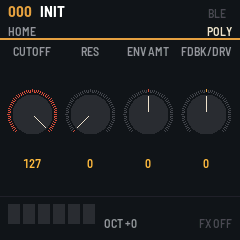
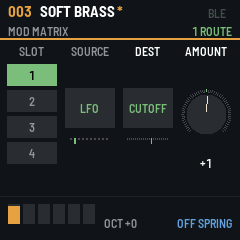

# TRI-6 FM-1

TRI-6 FM-1 is a six-voice polysynth for the M-VAVE FM-1 in the style of the Sequential Trigon-6: three oscillators a
voice with sync, noise, feedback and drive into a 2/4-pole ladder filter, two envelopes, an LFO, poly mod, vintage,
distortion, two effects, an eight-slot mod matrix, unison with chord memory and an arpeggiator.

This is version {{VERSION}}. You install it at your own risk, and the installer can put M-VAVE's own firmware back.

- [Play it in your browser](play/): the real firmware on an emulated FM-1, no FM-1 needed.
- [Install](install/) it from Chrome or Edge, with the FM-1 connected by USB.
- [Download {{PKG}}](firmware/{{PKG}}) to use the command-line installer: `python3 tools/fm1_install.py {{PKG}}`.
- The source is under MPL-2.0. It's built on fm1-base and felucca-bsp, which come from Felucca by Leo Kuroshita,
  Hügelton Instruments.

Sequential, Trigon-6, M-VAVE and FM-1 are trademarks of their owners. TRI-6 FM-1 is unofficial and not affiliated with
Sequential or M-VAVE.
